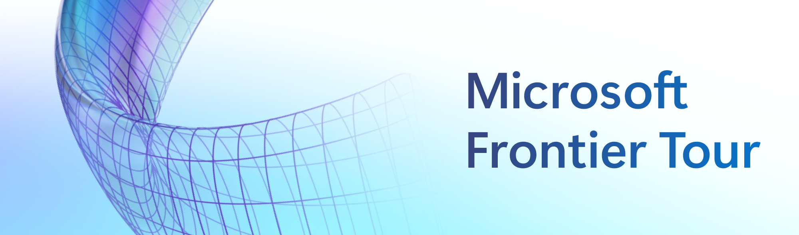

<p align="center">

</p>

# Microsoft Frontier Tour 2027

## LTG243: Fabric IQ - From rows to reliable answers

This lightning talk follows one Hydration Sunscreen decision from synthetic rows
to governed business meaning, a grounded Fabric data-agent answer, and reusable
organizational knowledge. This repository contains the deployable Microsoft
Fabric estate used for that demonstration: the synthetic Caldova data, Fabric IQ
ontology, Direct Lake semantic model, Fabric data agent, deployment automation,
and verification checks.

All business records are synthetic and fictional.

> **Recommended:** Run the setup with GitHub Copilot or your preferred coding
> agent using the [agent runbook](instructions/copilot.md). The complete manual
> steps remain below.

## Fastest setup

The demo is Fabric-only. It does not require an Azure subscription, Azure SQL
logical server, Azure OpenAI deployment, or a separate application host.

1. Install Node.js 24 or later, Bash or PowerShell 7, and
   [Fabio CLI](https://github.com/iemejia/fabio) **0.79.0**, pinned in
   [`.fabio-version`](.fabio-version). If Fabio is already installed, run
   `fabio upgrade --target-version 0.79.0`. Both deployment scripts require this
   exact version for reproducible setup. For a fresh installation, follow the
   [installation steps](instructions/README.md#0-install-the-pinned-fabio-version).
   Install [Azure CLI](https://learn.microsoft.com/cli/azure/install-azure-cli)
   for Fabio's default local sign-in; no Azure subscription is required.
2. Use a Microsoft Fabric tenant with capacity and an empty or disposable
   workspace where you can create and load the required item types.
3. From the repository root, validate locally and review a dry run (Bash):

   ```sh
   node data/tools/manifest.ts --check
   node data/tools/validate.ts
   read -r -p "Fabric workspace ID: " workspace_id
   ./create-data.sh --workspace "$workspace_id" --dry-run
   ```

4. Sign in to the workspace's tenant and confirm access before deploying:

   ```sh
   read -r -p "Fabric tenant ID or domain: " fabric_tenant
   az login --tenant "$fabric_tenant" --allow-no-subscriptions
   fabio auth login --tenant "$fabric_tenant"
   fabio auth status
   fabio workspace show --id "$workspace_id" -o table
   ```

   Stop if the workspace lookup fails. VS Code sign-in or Azure subscription
   access alone does not establish Fabio access to this workspace. Fabio 0.79.0
   native `--browser` login requires a customer-owned public-client application;
   it is not the default setup path.

5. After reviewing the dry run and confirming the workspace, deploy and verify:

   ```sh
   ./create-data.sh --workspace "$workspace_id"
   ./create-data.sh --workspace "$workspace_id" --verify-only --evaluate-agent
   ```

PowerShell presenters can use `pwsh ./create-data.ps1` with the same options.
For copy-pasteable PowerShell commands and the complete walkthrough, see the
[setup and demo guide](instructions/README.md).

## What the deployment creates

| Fabric item | Default name | Role in LTG243 |
| --- | --- | --- |
| Lakehouse | `CaldovaAnalytics` | Narrative evidence and analytical Delta tables |
| Eventhouse and KQL database | `CaldovaSignals` | Forecast, sales, weather, and line signals |
| Fabric SQL Database | `CaldovaOperations` | Governed relational business records |
| Fabric IQ ontology | `CaldovaBusinessMeaning` | Entities, relationships, and bound business meaning |
| Direct Lake semantic model | `CaldovaLaunchModel` | Named measures and analytical grounding |
| Fabric data agent | `CaldovaAnalyst` | Grounded question, answer, and source inspection |

The exact hero question is:

> What's driving the increase in Hydration Sunscreen sales, and is it likely to continue?

The data agent is non-deterministic. Evaluate the returned facts and sources
rather than expecting byte-identical prose.

## Repository contents

| Path | Contents |
| --- | --- |
| [`data/`](data/README.md) | Deterministic synthetic data, generator, validator, manifest, and expected-answer checks |
| [`src/fabric/`](src/README.md) | Fabric IQ ontology, semantic model, and data-agent definitions |
| [`create-data.sh`](create-data.sh) | One-command Bash deployment and verification entry point |
| [`create-data.ps1`](create-data.ps1) | Equivalent PowerShell deployment entry point |
| [`instructions/`](instructions/README.md) | Presenter and self-paced environment setup |
| [`docs/`](docs/README.md) | Scenario and technical reference |
| [`delivery-resources/`](delivery-resources/README.md) | Re-delivery preflight and demo cues |

Workspace IDs, item IDs, tokens, screenshots, and deployment output stay local.

## Learning outcomes

By the end of this session, you will be able to:

- Explain how Fabric IQ binds governed business meaning to operational and
  analytical data.
- Ground a Fabric data agent in configured semantic, KQL, Lakehouse, and ontology
  surfaces.
- Check a generated answer against retained sources and expected facts.

## Continue learning

| Resource | What you'll get |
|----------|-----------------|
| **[Session Recording](https://aka.ms/ft27/ltg243/youtube)** | A recording of session LTG243 by the session creator |
| **[Microsoft Learn](https://learn.microsoft.com)** | Official documentation and guided learning paths on these topics |
| **[Frontier Tour 2027 Resource Center](https://aka.ms/FrontierTour27)** | Additional session repos and materials from Frontier Tour 2027 |
| **[Microsoft Foundry Community](https://aka.ms/MicrosoftFoundryDiscord-ft27)** | Connect with other learners and experts in our Discord community |

The [Microsoft Learn MCP Server](https://aka.ms/learnmcp) can give an AI coding
agent current first-party documentation while it helps with setup.

### 👥 Content owners

<table>
<tr>
    <td align="center"><a href="https://github.com/videlalvaro">
        <br />
        <sub><b>Alvaro Videla</b></sub></a><br />
            <a href="https://github.com/videlalvaro" title="talk">📢</a>
    </td>
</tr></table>

### Deliver this session

Presenters and re-delivery partners can find the deck, recordings, presenter
notes, and delivery guidance in [`delivery-resources/`](delivery-resources/README.md).

## Trademarks

This project may contain trademarks or logos for projects, products, or
services. Authorized use of Microsoft trademarks or logos is subject to
[Microsoft's Trademark & Brand Guidelines](https://www.microsoft.com/legal/intellectualproperty/trademarks/usage/general).
